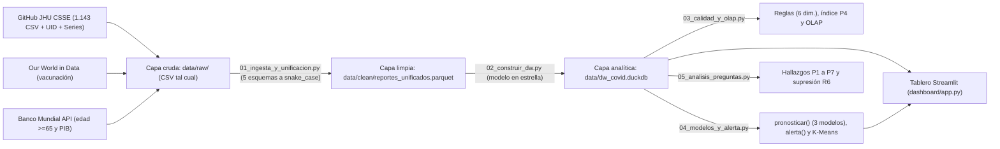
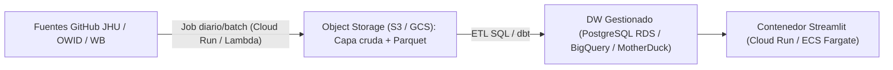

# Arquitectura (R1)

## Arquitectura por capas en el entorno local

## Comparación CSV frente a Parquet

Medición real ejecutada sobre los `1.143` reportes diarios de JHU (`4.287.473` filas unificadas):

| Formato | Tamaño en disco | Tiempo de lectura completo | Mejora |
|---|---:|---:|---|
| CSV (`1.143` archivos diarios) | 559,87 MB | ~43,80 s | Línea base |
| Parquet (`reportes_unificados.parquet`) | 96,07 MB | 7,44 s | **82,8 % menos espacio · 5,9x más rápido** |

## Por qué DuckDB / PostgreSQL y no NoSQL (S4)

1. **Esquema tabular estable:** tras unificar los 5 esquemas históricos en `snake_case`, las `4.287.473` filas comparten 16 columnas tipadas sin estructuras anidadas ni documentos heterogéneos.
2. **Consultas analíticas e integridad referencial (OLAP):** el modelo en estrella requiere `JOIN` eficientes entre `fact_covid` (`4,28M` filas), `fact_vacunacion`, `dim_fecha` y `dim_territorio`, funciones ventana (`LAG`) para calcular variaciones diarias y agregaciones `GROUP BY` / `ROLLUP` / `CUBE`.
3. **Por qué NoSQL no aporta aquí:**
   - Una base documental como **MongoDB** duplicaría metadatos territoriales en millones de documentos o penalizaría los cruces (`$lookup`) frente a un motor columnar analítico.
   - Una base de escritura masiva como **Cassandra** está optimizada para ingesta distribuida por clave de partición conocida, pero restringe las consultas ad-hoc (`slice`, `dice`, `drill-down`) que exige el Comité.
4. **Elección de DuckDB en producción local:** lee Parquet directamente con SQL, ejecuta consultas columnares vectorizadas en milisegundos sin servidor externo y garantiza reproducibilidad con un solo comando. (Si se escalara a decenas de usuarios concurrentes escribiendo en línea, el mismo esquema SQL en `sql/` migra directo a **PostgreSQL**.)

## Equivalente en la nube y estimación de costo mensual (R1 Excelente)

| Servicio equivalente (AWS / GCP) | Rol en la arquitectura | Uso estimado | Costo mensual aprox. (USD) |
|---|---|---|---:|
| Amazon S3 / Google Cloud Storage | Capa cruda (560 MB) + Capa limpia Parquet (96 MB) | < 1 GB almacenamiento + lecturas | ~\$0,50 |
| AWS Lambda / Cloud Run Jobs | Orquestación batch de ingesta y calidad | 1 ejecución diaria (~2 min) | ~\$0,00 (capa gratuita) |
| RDS PostgreSQL (`db.t4g.micro`) o MotherDuck | Data Warehouse en estrella (~150 MB) | 1 instancia pequeña 24/7 | ~\$13,00 – \$15,00 |
| Cloud Run / App Runner (contenedor Streamlit) | Tablero interactivo del Comité | Bajo demanda (sesiones de comité) | ~\$3,00 – \$5,00 |
| **Total estimado** | | | **~\$16,50 – \$20,50 USD/mes** |
