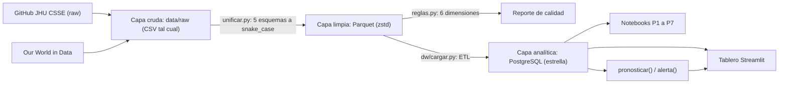

# Arquitectura (R1)

## Comparación CSV frente a Parquet

| Formato | Tamaño (MB) | Lectura (s) |
|---|---|---|
| CSV (1.143 archivos) | | |
| Parquet (zstd) | | |

(Salida de `comparar_csv_parquet()`.)

## Por qué PostgreSQL y no NoSQL (S4)

TODO (A): datos tabulares con esquema estable después de unificar; consultas analíticas con JOIN y agregaciones (OLAP, ROLLUP); integridad referencial en la estrella; comparación con MongoDB (documentos) o Cassandra (escritura masiva) y por qué aquí no aportan.

## Equivalente en la nube (excelente)

TODO (A, si sobra tiempo): por ejemplo, S3/GCS para las capas cruda y limpia, RDS/Cloud SQL para el DW y la app en un contenedor, con una estimación de costo mensual.
