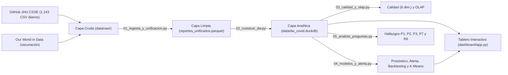

# Guía de Estudio y Defensa · Sala de Crisis COVID-19 (IN1232C)

Documento de estudio integral para preparar la sesión del Comité. Cubre qué es el proyecto, de qué se compone, cómo se ejecuta y cómo responder las preguntas técnicas y de negocio.

---

## 1. Qué es el proyecto

Es una **plataforma analítica, Data Warehouse y tablero interactivo** construida sobre el registro histórico completo de COVID-19 de **Johns Hopkins University CSSE** (`2020-01-22` al `2023-03-09`, `1.143` reportes diarios), integrado con la fuente externa de vacunación de **Our World in Data (OWID)**.

Su propósito es permitir que un Comité de Crisis:
1. Explore la evolución histórica por país o región de Chile con tasas comparables por `100.000` habitantes.
2. Evalúe la confiabilidad de los datos antes de tomar decisiones (calidad en 6 dimensiones e índice por país).
3. Ejecute pronósticos y alertas tempranas en vivo **sin fuga de datos futuros** para cualquier fecha de corte histórica.

---

## 2. De qué se compone (Arquitectura en capas)



### Componentes principales del repositorio

| Capa / Carpeta | Archivos clave | Función |
|---|---|---|
| **Ingesta (Capa Cruda -> Limpia)** | `src/01_ingesta_y_unificacion.py` | Descarga los `1.143` CSV diarios, series globales, tabla maestra `UID_ISO_FIPS_LookUp_Table.csv` y OWID; unifica **5 esquemas históricos** en `snake_case` a `data/clean/reportes_unificados.parquet` (`4.287.473` filas). |
| **Data Warehouse (Capa Analítica)** | `src/02_construir_dw.py` | Construye el **modelo en estrella** en **DuckDB** (`data/dw_covid.duckdb`) con `dim_fecha`, `dim_territorio`, `fact_covid` y `fact_vacunacion`. |
| **Calidad y OLAP** | `src/03_calidad_y_olap.py`, `src/calidad/reglas.py`, `src/calidad/indice.py` | Evalúa 6 dimensiones de calidad, calcula el índice de calidad por país (`P4`) y ejecuta consultas OLAP (`roll-up`, `slice`, `drill-down` + `dice`). |
| **Modelos y Alerta Temprana** | `src/04_modelos_y_alerta.py` | Implementa `pronosticar()` (Base MM7 y Holt amortiguado), `alerta()`, backtesting en 3 cortes y segmentación K-Means (`P5`). |
| **Análisis de Preguntas** | `src/05_analisis_preguntas.py` | Genera métricas y gráficos (`docs/figuras/`) para P1, P2, P3, P7 y la medición de supresión R6. |
| **Protección de Datos** | `src/proteccion/supresion.py` | Implementa la supresión de celdas pequeñas (`1` a `4` en poblaciones bajas) y mide el porcentaje de información perdida. |
| **Tablero Interactivo** | `dashboard/app.py` | Aplicación Streamlit en 4 pestañas: Panorama y Tendencias, Mapas Mundial y Chile, Desafío en Vivo, Calidad y Segmentación. |
| **Documentación y Notebooks** | `docs/*.md`, `notebooks/*.ipynb` | Diccionario de datos, decisiones de calidad, protección de datos, guion, informe técnico y notebooks por rol. |

---

## 3. Modelo de datos (Esquema en Estrella en DuckDB)

- **Grano de `fact_covid`:** `1` fila por `(territorio_key, fecha_key)` (`4.287.467` filas tras consolidar 6 duplicados del crudo; `4.413` territorios distintos).
- **Tablas de dimensiones:**
  - `dim_fecha`: `fecha_key` (`YYYYMMDD`), `fecha`, `anio`, `mes`, `anio_mes`, `trimestre`, `semana_anio`, `dia_semana`, `es_fin_semana`.
  - `dim_territorio`: `territorio_key`, `combined_key`, `country_region`, `province_state`, `admin2`, `iso3`, `population`, `lat`, `long`, `nivel_granularidad` (`pais`, `region_estado`, `condado`), `es_entidad_especial` (`TRUE` para `27` territorios como *Diamond Princess*, *MS Zaandam*, Juegos Olímpicos, *Antarctica*, `Unknown`).
- **Tablas de hechos:**
  - `fact_covid`: `confirmed`, `deaths`, `recovered`, `active`, `casos_nuevos`, `fallecidos_nuevos`, `retrocede_casos`, `retrocede_fallecidos`, `incident_rate`, `case_fatality_ratio`.
  - `fact_vacunacion`: datos de OWID filtrando agregados `OWID_*`, cruzados por código `iso3`.
- **Tasa de cruce JHU vs. OWID:** de `236` códigos `iso3` en JHU (`dim_territorio`), `215` cruzan con `fact_vacunacion` (**`91,1 %`** de cobertura).

---

## 4. Cómo se usa y se reproduce

Con el entorno virtual `.venv` activado (`.\.venv\Scripts\Activate.ps1`):

1. **Ejecutar el pipeline completo (en orden):**
   ```powershell
   python -u src/01_ingesta_y_unificacion.py
   python -u src/02_construir_dw.py
   python -u src/03_calidad_y_olap.py
   python -u src/04_modelos_y_alerta.py
   python -u src/05_analisis_preguntas.py
   ```
2. **Ejecutar pruebas unitarias:**
   ```powershell
   python -m pytest -q
   ```
3. **Levantar el tablero interactivo:**
   ```powershell
   streamlit run dashboard/app.py
   ```
   Se abre en `http://localhost:8501`.

### Cómo usar el tablero en vivo
- **Barra lateral:** elegir `País` o `Región de Chile`, seleccionar el territorio, definir la **Fecha de corte de los datos** (`2020-02-15` a `2023-03-09`) y ajustar los umbrales de alerta temprana (`incidencia 7d >= 35,0 c/100k` y `variación semanal >= 25,0 %` por defecto).
- **Pestaña 1 (Panorama y Tendencias):** estado de alerta, KPIs (con supresión R6), curva diaria + MM7 y avance de vacunación OWID.
- **Pestaña 2 (Mapas Mundial y Chile):** mapas de burbujas por 100.000 hab. y rankings Top 10 / 16 regiones de Chile.
- **Pestaña 3 (Desafío en Vivo):** ejecuta `pronosticar()` y `alerta()` usando solo datos `<= fecha_corte`. Con el interruptor *"Comparar con lo que realmente ocurrió"* (para fechas anteriores al `2023-03-09`) superpone la curva real, calcula **MAE** y **MAPE** y muestra la tabla día a día.
- **Pestaña 4 (Calidad y Segmentación):** muestra en formato vertical `1x4` las reglas de calidad (`R2`), el Top 10 de peores países (`P4`), la segmentación K-Means (`P5`) y el backtesting en 3 cortes de Chile (`R5`).

---

## 5. Resumen de hallazgos (P1 a P7)

| Pregunta | Hallazgo principal con cifras reales |
|---|---|
| **P1 · Chile frente a Sudamérica** | Al `2023-03-09`, Chile fue **2.° en casos** por 100k (`27.161,7`, detrás de Uruguay `29.775,0`) y **2.° en fallecidos** por 100k (`336,2`, detrás de Perú `665,8`). |
| **P2 · Regiones de Chile y Biobío** | Entre las 16 regiones (desde `2020-05-20`), Magallanes lidera en casos (`40.624,4/100k`) y fallecidos (`464,8/100k`). **Biobío** ocupa el lugar **#9 en casos/100k** (`32.806,3`) y **#10 en fallecidos/100k** (`309,9`). |
| **P3 · Letalidad vs. vacunación** | Comparando la mediana de letalidad mensual antes vs. después de alcanzar `50 %` de vacunación completa: **Chile** `2,10 % -> 0,64 %`, **Argentina** `2,30 % -> 0,41 %`, **Perú** `7,56 % -> 1,56 %`, **Uruguay** `1,73 % -> 0,46 %` (sujeto a sesgo de testeo y cambio de variantes). |
| **P4 · Índice de calidad por país** | Peores puntajes (escala 0–100): `US` (`0,00`), `United Kingdom` (`34,91`), `Iran (Islamic Republic of)` (`50,04`), `Republic of Korea` (`50,04`), `South Korea` (`52,10`), `Tanzania` (`52,60`), `Congo (Brazzaville)` (`56,58`), `Nicaragua` (`56,94`), `Benin` (`57,37`), `Cameroon` (`57,72`). |
| **P5 · Segmentación K-Means** | 4 perfiles de países: **Grupo 0** (56 países, baja incidencia ~1.914/100k y baja vacunación ~24,1 %), **Grupo 1** (55 países como EE. UU., Brasil, Chile, alta carga ~35.087/100k y alta vacunación ~64,5 %), **Grupo 2** (Yemen, atípico con 18,1 % letalidad y 2,3 % vac.) y **Grupo 3** (55 países como India/China, carga moderada ~9.474/100k y alta vacunación ~68,5 %). |
| **P6 · Corte dic-2021 (Ómicron)** | Al `2021-12-28` (antes del explosivo alza de ómicron), el modelo Base MM7 obtuvo `MAE = 716,3` (`MAPE = 29,2 %`) y Holt `MAE = 783,8` (`MAPE = 32,8 %`). Ningún modelo univariado sin datos externos de variantes anticipa un cambio de régimen abrupto como ómicron. |
| **P7 · Vacunación dic-2021 vs. mortalidad 2022** | En `n = 151` países (`>= 1M` hab.), la correlación de Pearson es `r = 0,488` (positiva). **Correlación no implica causalidad:** los países más vacunados tienen poblaciones más envejecidas y mejor registro de defunciones, mientras países jóvenes presentan subregistro. |

---

## 6. Banco de preguntas frecuentes de la Comisión (y cómo responderlas)

1. **¿Por qué no se pueden sumar directamente los valores acumulados (`confirmed`, `deaths`)? ¿Cómo calcularon los casos nuevos?**
   - Porque cada fila ya contiene el **acumulado histórico** hasta esa fecha. Sumar acumulados entre días multiplicaría los mismos casos cientos de veces.
   - Los casos nuevos diarios se calculan como la diferencia respecto al día anterior usando SQL `LAG(confirmed) OVER (PARTITION BY territorio_key ORDER BY fecha_key)` en `fact_covid` (o `.diff()` en `obtener_serie_territorio()`).

2. **¿Qué hicieron con los acumulados que retroceden (`casos_nuevos < 0`)? ¿Por qué no imputaron?**
   - Regla del curso: **corregir, marcar o excluir; imputar es inventar**.
   - Detectamos `44.582` filas (`1,04 %`) donde el acumulado retrocede por correcciones oficiales retrospectivas. Se **marcaron** en `fact_covid` (`retrocede_casos = TRUE`) y para agregaciones o medias móviles se acotan con `GREATEST(casos_nuevos, 0)` (o `.clip(lower=0)`), conservando intacto el registro oficial.

3. **¿Cómo garantizan que `pronosticar()` y `alerta()` no tienen fuga de datos del futuro?**
   - Tanto `obtener_serie_territorio(territorio, fecha_corte)` como la consulta SQL filtran estrictamente `d.fecha <= fecha_corte` antes de calcular medias móviles, ajustar Holt o evaluar la alerta. Además, la prueba unitaria `test_recortar_no_filtra_futuro` en `tests/test_basicos.py` verifica esta propiedad.

4. **¿Cuál es el grano de la tabla de hechos y qué es un `roll-up` en su DW?**
   - El grano de `fact_covid` es **un territorio por día** (`territorio_key, fecha_key`).
   - Un `roll-up` consiste en subir en la jerarquía de una dimensión agregando medidas; por ejemplo, sumar `casos_nuevos` desde el grano diario hacia `anio` y `trimestre` en `dim_fecha`.

5. **¿Por qué usaron un motor tabular/relacional (DuckDB / PostgreSQL) y Parquet en vez de CSV o NoSQL (MongoDB)?**
   - Tras unificar los 5 esquemas en `snake_case`, los datos son estrictamente tabulares y estables. Un motor relacional analítico permite `JOIN` eficientes entre hechos y dimensiones, funciones ventana (`LAG`) y agregaciones OLAP (`ROLLUP`), cosas para las que una base documental como MongoDB no está optimizada.
   - Frente a `1.143` archivos CSV separados, **Parquet** (formato columnar comprimido) reduce drásticamente el tamaño en disco y acelera las lecturas selectivas de columnas.

6. **¿Los datos usados son datos personales según la Ley 19.628 y la Ley 21.719?**
   - No en términos generales, porque son conteos agregados por territorio sin identificadores directos de personas naturales.
   - Sin embargo, en **poblaciones pequeñas con conteos entre 1 y 4** existe riesgo de reidentificación indirecta. Por ello aplicamos **control de divulgación (R6)**: en el tablero ocultamos esos conteos como `<5 (suprimido R6)` cuando la población es `< 50.000` hab., y en el análisis estricto sobre `316` condados de EE. UU. con `< 5.000` hab. demostramos que la pérdida de información es mínima (`1,79 %` en casos y `0,10 %` en fallecidos).

7. **¿Qué significa un `MAPE` de ~29 % o ~10 % en su backtesting?**
   - El **MAPE** (*Mean Absolute Percentage Error*) mide el error porcentual promedio respecto al valor real observado en los 14 días posteriores al corte. Un `MAPE` de `10,5 %` (como Holt en marzo 2021) indica que el pronóstico se desvía en promedio ~10,5 % de los casos reales diarios; un `MAPE` de `32,8 %` en diciembre 2021 refleja la dificultad de anticipar el quiebre abrupto de la variante ómicron solo con la serie histórica previa.

8. **¿Qué ocurre con Chile en mayo de 2020 y por qué hay que tener cuidado al consultar?**
   - Hasta mediados de mayo de 2020, JHU reportaba a Chile como un solo registro nacional; desde el `2020-05-20` pasa a desagregarse en **16 regiones** (`province_state`). Si se sumara ingenuamente la población de nivel país + regiones se duplicaría la población de Chile; por eso nuestras consultas usan `nivel_granularidad` y `COALESCE` para tomar la población correcta sin doble conteo.
