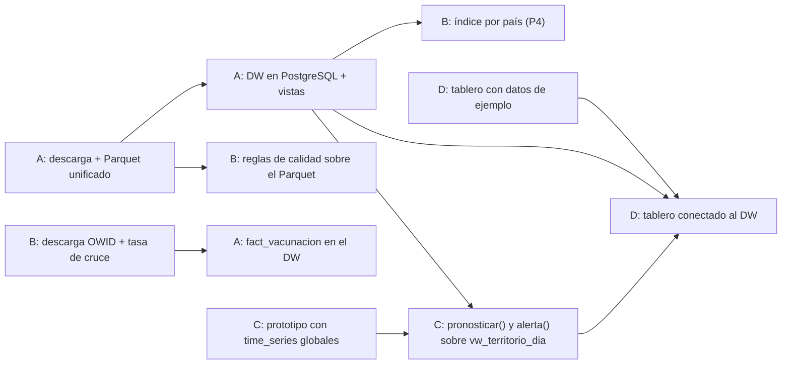

# Guía de trabajo del equipo

Basada en el enunciado, la PPT S14 y el plan de trabajo del 21-nov. Es una propuesta: el equipo la ajusta en la reunión de arranque.

## 1. Situación real

| Fecha | Qué ocurre | Tiempo restante |
|---|---|---|
| Sáb 21-nov (noche) | Arranque y plataforma de datos | |
| Dom 22-nov | Análisis, modelos y tablero; por la noche **se congela el tablero** | |
| Lun 23-nov | Holgura: correcciones, P7, informes y ensayo | |
| **Mar 24-nov** | **Sesión del Comité (15 min)** | 3 días |
| **Mié 25-nov 23:59** | **Entrega: repo en GitHub y .zip en EVA** (−10 pts por día de atraso) | 4 días |

Los hitos 1 a 3 ya pasaron. Como «Proceso» (5 pts) y el factor de coevaluación (0,8 a 1,0) se miran en el **historial del repositorio**, desde hoy **cada integrante hace commits con su propia cuenta**.

## 2. Decisiones que hay que cerrar en los primeros 30 minutos

| Tema | Recomendación | Por qué |
|---|---|---|
| Motor del DW | PostgreSQL (ya decidido) | |
| Herramienta del tablero | **Streamlit** | Permite ejecutar `pronosticar()` y `alerta()` dentro del tablero durante el desafío en vivo y se conecta directo a PostgreSQL. Power BI o Metabase obligarían a mostrar el pronóstico aparte |
| Fuente externa | **OWID vacunación** (obligatoria en la práctica) | Es la única que trae el % de vacunados que pide P3. Banco Mundial como segunda fuente solo si sobra tiempo (nivel excelente de R3) |
| P7 | Por ejemplo: «¿los países con mayor % de vacunación completa a mediados de 2021 tuvieron menor letalidad aparente en la ola de ómicron?» | Usa la misma fuente que P3 y evita una segunda integración |
| Computador para el Comité | Definir hoy | Debe tener PostgreSQL, el DW cargado y el tablero |

## 3. Roles y responsabilidades

Cada rol tiene un **dueño** y un **revisor**. El revisor aprueba los PR del dueño y debe ser capaz de explicar su parte ante el Comité.

| Rol | Persona | Componentes (puntos de la rúbrica A) | Archivos de los que es dueño | Revisor |
|---|---|---|---|---|
| **A · Ingeniería de datos** | | R1 (12), R3 (13) | `src/ingesta/`, `src/dw/`, `src/pipeline.py`, `sql/`, notebooks 01 y 03, `docs/arquitectura.md` | C |
| **B · Calidad, ética y fuente externa** | | R2 (15), R6 (7), P3, P4, P7 | `src/calidad/`, `src/externas/`, `src/proteccion/`, notebooks 02 y 06, `docs/diccionario_datos.md`, `docs/decisiones_calidad.md`, `docs/proteccion_datos.md` | D |
| **C · Modelos** | | R5 (15), P5, P6 | `src/modelos/`, notebook 05, `tests/` | A |
| **D · Tablero y comunicación** | | R7 (10), R8 (5), P1, P2, Proceso | `dashboard/`, notebook 00, `README.md`, `docs/informe_*.md`, `docs/guion_comite.md`, `contribuciones.md` | B |

El notebook 04 (P1 a P7) se divide por secciones: D escribe P1 y P2, B escribe P3, P4 y P7, y C escribe P5 y P6. Para evitar conflictos de merge, **cada uno trabaja su parte en un notebook propio** (`04a_P1_P2.ipynb`, `04b_P3_P4_P7.ipynb`, `04c_P5_P6.ipynb`) y D los consolida el lunes.

### Por qué este reparto

- A tiene la carga técnica más alta (25 pts) y es el **camino crítico**: todos dependen de su Parquet y de su DW. Por eso no tiene preguntas de análisis.
- B agrupa todo lo que es «confiabilidad»: calidad, ética y la fuente externa con la que se responden P3 y P7.
- C tiene las funciones que se prueban en vivo; su trabajo pesa doble (R5 y el desafío, que vale 25 de los 100 pts de la rúbrica B).
- D construye lo que el Comité ve: el tablero, el relato y los informes. P1 y P2 son los mismos gráficos que van al tablero.

## 4. Dependencias y cómo trabajar en paralelo desde hoy

**Para no quedarse esperando a A:**

- **C** prototipa hoy con `data/raw/time_series/time_series_covid19_confirmed_global.csv` (formato ancho; `melt` a largo y `diff` para nuevos diarios). Cuando exista `vw_territorio_dia`, solo cambia la fuente en `src/modelos/datos.py`.
- **B** escribe las reglas sobre el Parquet apenas A lo suba (meta: hoy antes de medianoche), y mientras tanto descarga OWID y calcula la tasa de cruce contra la tabla UID.
- **D** arma el layout de Streamlit con un DataFrame de ejemplo y lo conecta al DW el domingo.

**Contratos que no se cambian sin avisar en el grupo:**

1. Columnas del Parquet unificado: [diccionario_datos.md](diccionario_datos.md).
2. Tablas del DW: [01_esquema.sql](../sql/01_esquema.sql).
3. Vista para modelos y tablero: `vw_territorio_dia(territorio, fecha, casos_nuevos, fallecidos_nuevos, poblacion)`. A y C la acuerdan hoy.
4. Firmas: `pronosticar(territorio, fecha_corte, horizonte=14)` y `alerta(territorio, fecha)`.

## 5. Cronograma por persona

### Sábado 21 (desde ahora)

| Persona | Tareas | Meta de la noche |
|---|---|---|
| Todos (30 min) | Clonar, crear `.venv`, instalar PostgreSQL y crear la base `sala_crisis`; cerrar las decisiones de la sección 2 | Todos con `pytest -q` en verde |
| A | `python -m src.pipeline descargar unificar`; revisar filas por esquema; normalizar países; empezar `dim_territorio` y `fact_covid_diario` | Parquet en `data/clean/` subido al repo |
| B | Descargar OWID y calcular la tasa de cruce; completar las reglas TODO de `reglas.py`; borrador del argumento legal | Reglas de las 6 dimensiones corriendo sobre el Parquet |
| C | Prototipo de `pronosticar()` (media móvil + Holt) y `alerta()` con las time series | Ambas funciones devuelven resultados para Chile |
| D | Notebook 00 completo; layout del tablero con filtros y pestañas; README actualizado | Tablero levanta con datos de ejemplo |

### Domingo 22

| Persona | Mañana | Tarde | Noche |
|---|---|---|---|
| A | DW cargado, conciliación y `vw_territorio_dia` | `fact_vacunacion`, consultas OLAP, apoyo al tablero | Exportar el DW a `data/dw/` |
| B | Cuantificar problemas e índice de calidad (P4) | P3 con OWID | Decisiones documentadas y diccionario |
| C | Backtesting en 3 cortes (MAE, MAPE) | Segmentación (P5) y P6 (corte dic-2021) | Evaluación de la alerta en Chile |
| D | P1 y P2 | Tablero conectado: KPI, tendencia, ranking, mapas, alerta | **Congelar el tablero** y probar el desafío en vivo |

Al cierre del domingo **todos** prueban el README desde cero en una carpeta nueva.

### Lunes 23

| Persona | Tareas |
|---|---|
| A | Arquitectura y justificación del motor; sección 2 y 4 del informe técnico |
| B | P7, supresión en el tablero (con D), secciones 3 y 7 del informe técnico |
| C | Secciones 6 del informe técnico; ensayar `pronosticar()` con 5 sorteos al azar |
| D | Informe al Comité (3 recomendaciones con KPI y responsable); ensambla el informe técnico |
| Todos (tarde) | **Sesión de enseñanza cruzada** (sección 7) y 2 ensayos cronometrados del relato |

Regla del lunes: **no se agregan funciones nuevas al tablero**, solo correcciones.

### Martes 24 y miércoles 25

- Martes: sesión del Comité según [guion_comite.md](guion_comite.md).
- Miércoles: exportar los informes a PDF, completar `contribuciones.md`, probar el README una última vez, crear el `.zip` y subirlo a EVA **antes de las 20:00** (margen de 4 horas).

## 6. Flujo de trabajo con Git

1. `main` siempre funciona. Nadie hace push directo a `main`.
2. Una rama por tarea: `a/unificar-esquemas`, `b/reglas-calidad`, `c/backtesting`, `d/tablero-mapas`.
3. Commits pequeños y descriptivos: `feat(calidad): regla de días sin reporte`, `fix(dw): duplicados en vw_pais_dia`.
4. Pull request hacia `main` con la plantilla; lo aprueba el revisor asignado (sección 3).
5. Antes de empezar cada bloque: `git pull origin main`.
6. **Un notebook, un dueño.** La lógica va en `src/` y los notebooks solo la llaman; así se evitan los conflictos en archivos `.ipynb`.
7. Nunca subir `data/raw/` ni `.env`.

## 7. Todos deben poder explicar todo

El Comité pregunta a cualquier integrante (20 pts de la rúbrica B) y lo que no se puede explicar «se considera no realizado».

- **Revisión cruzada:** el revisor de cada parte la entiende lo suficiente para defenderla.
- **Enseñanza cruzada (lunes tarde, 15 min por persona):** cada dueño explica su parte y los otros tres hacen preguntas tipo Comité.
- **Preguntas que todos deben saber responder:**
  - ¿Por qué no se pueden sumar los acumulados? ¿Cómo calcularon los casos nuevos?
  - ¿Cuál es el grano de la tabla de hechos? ¿Qué es un roll-up en su DW?
  - ¿Cómo garantizan que `pronosticar()` no usa datos posteriores al corte?
  - ¿Qué hicieron con los acumulados que retroceden? ¿Por qué no imputaron?
  - ¿Por qué PostgreSQL y no MongoDB?
  - ¿Son datos personales según la Ley 21.719?
  - ¿Qué significa un MAPE de X % en su backtesting?

## 8. Si el tiempo no alcanza

1. **Nunca se recorta (prioridad 1):** pipeline reproducible con un comando (sin eso, R1 vale 0), DW cargado, tablero con filtros por territorio y fecha, y `pronosticar()` y `alerta()` con fecha de corte.
2. **Se reduce la profundidad, no la existencia (prioridad 2):** calidad, P1 a P7, segmentación, protección de datos e informe al Comité.
3. **Se recorta primero (prioridad 3):** mapa animado o coroplético, segunda fuente, arquitectura en la nube, linaje completo y condados de EE.UU.

## 9. Coordinación

- Tres puntos de control diarios de 10 minutos (por ejemplo, 10:00, 16:00 y 22:00): qué terminé, qué sigo y qué me bloquea.
- Los bloqueos con datos se escalan a A de inmediato; si un contrato cambia, se avisa en el grupo antes de hacer merge.
